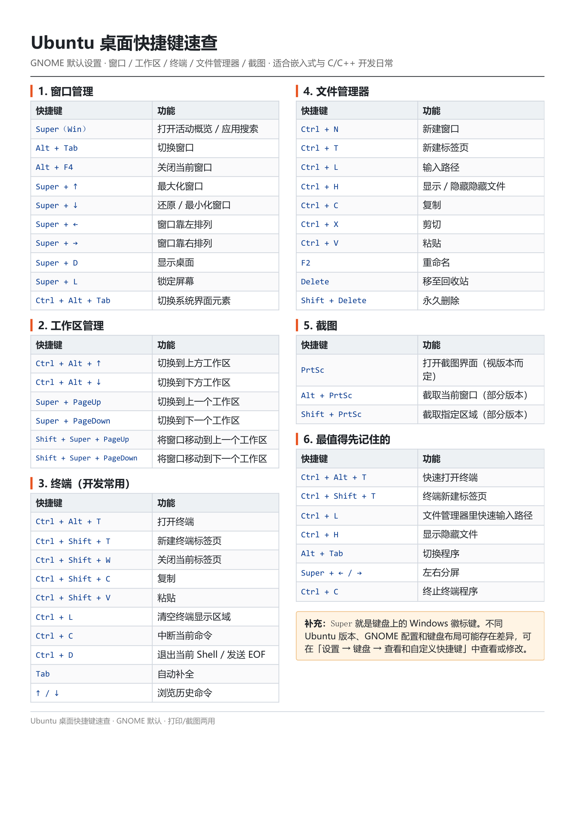

# Ubuntu 桌面快捷键（GNOME 默认）

[← 返回笔记索引](../../README.md)

整理 Ubuntu 桌面常用快捷键，重点在窗口管理、终端和开发日常操作。适合用 Ubuntu 做 C/C++、STM32、嵌入式 Linux 开发时快速上手。



## 文件

| 文件 | 说明 |
|---|---|
| [Ubuntu快捷键速查.png](Ubuntu快捷键速查.png) | 速查图，A4 竖版，200 dpi，适合手机查看或贴图 |
| [Ubuntu快捷键速查.pdf](Ubuntu快捷键速查.pdf) | PDF 单页版，适合打印 |
| [ubuntu-shortcuts.html](ubuntu-shortcuts.html) | 源文件，改内容或样式后重新生成上面两个 |

## 1. 窗口管理

| 快捷键 | 功能 |
|---|---|
| `Super`（Win） | 打开活动概览 / 应用搜索 |
| `Alt + Tab` | 切换窗口 |
| `Alt + F4` | 关闭当前窗口 |
| `Super + ↑` | 最大化窗口 |
| `Super + ↓` | 还原 / 最小化窗口 |
| `Super + ←` | 窗口靠左排列 |
| `Super + →` | 窗口靠右排列 |
| `Super + D` | 显示桌面 |
| `Super + L` | 锁定屏幕 |
| `Ctrl + Alt + Tab` | 切换系统界面元素 |

## 2. 工作区管理

| 快捷键 | 功能 |
|---|---|
| `Ctrl + Alt + ↑` | 切换到上方工作区 |
| `Ctrl + Alt + ↓` | 切换到下方工作区 |
| `Super + PageUp` | 切换到上一个工作区 |
| `Super + PageDown` | 切换到下一个工作区 |
| `Shift + Super + PageUp` | 将窗口移动到上一个工作区 |
| `Shift + Super + PageDown` | 将窗口移动到下一个工作区 |

## 3. 终端（开发常用）

| 快捷键 | 功能 |
|---|---|
| `Ctrl + Alt + T` | 打开终端 |
| `Ctrl + Shift + T` | 新建终端标签页 |
| `Ctrl + Shift + W` | 关闭当前标签页 |
| `Ctrl + Shift + C` | 复制 |
| `Ctrl + Shift + V` | 粘贴 |
| `Ctrl + L` | 清空终端显示区域 |
| `Ctrl + C` | 中断当前命令 |
| `Ctrl + D` | 退出当前 Shell / 发送 EOF |
| `Tab` | 自动补全 |
| `↑ / ↓` | 浏览历史命令 |

> 终端里复制粘贴必须带 `Shift`，因为 `Ctrl + C` 已经被"中断当前命令"占用。

## 4. 文件管理器

| 快捷键 | 功能 |
|---|---|
| `Ctrl + N` | 新建窗口 |
| `Ctrl + T` | 新建标签页 |
| `Ctrl + L` | 输入路径 |
| `Ctrl + H` | 显示 / 隐藏隐藏文件 |
| `Ctrl + C` | 复制 |
| `Ctrl + X` | 剪切 |
| `Ctrl + V` | 粘贴 |
| `F2` | 重命名 |
| `Delete` | 移至回收站 |
| `Shift + Delete` | 永久删除 |

## 5. 截图

| 快捷键 | 功能 |
|---|---|
| `PrtSc` | 打开截图界面（视版本而定） |
| `Alt + PrtSc` | 截取当前窗口（部分版本） |
| `Shift + PrtSc` | 截取指定区域（部分版本） |

## 6. 最值得先记住的几个

| 快捷键 | 功能 |
|---|---|
| `Ctrl + Alt + T` | 快速打开终端 |
| `Ctrl + Shift + T` | 终端新建标签页 |
| `Ctrl + L` | 文件管理器里快速输入路径 |
| `Ctrl + H` | 显示隐藏文件 |
| `Alt + Tab` | 切换程序 |
| `Super + ← / →` | 左右分屏 |
| `Ctrl + C` | 终止终端程序 |

## 说明

- `Super` 就是键盘上的 Windows 徽标键。
- 不同 Ubuntu 版本、GNOME 配置和键盘布局可能存在差异，可在「设置 → 键盘 → 查看和自定义快捷键」中查看或修改。
- 截图快捷键在 Ubuntu 22.04 之后改成了交互式界面（`PrtSc` 弹出截图工具），更早的版本行为略有不同。

延伸阅读：[Ubuntu 完全教程](https://www.cnblogs.com/dutlei/archive/2012/11/20/2778327.html)（命令行、权限、压缩、用户管理等基础操作，也收在 [websites.md](../../../websites.md) 的参考文章里）。

## 重新生成图片和 PDF

在仓库根目录执行：

```powershell
# PDF
powershell -ExecutionPolicy Bypass -File tools\scripts\html-to-pdf.ps1 `
  -InputHtml notes\linux\ubuntu\ubuntu-shortcuts.html `
  -OutputPdf "notes\linux\ubuntu\Ubuntu快捷键速查.pdf"

# PNG（需要 pip install pymupdf）
python tools\scripts\pdf-preview.py "notes\linux\ubuntu\Ubuntu快捷键速查.pdf" `
  --page 1 --dpi 200 --out "notes\linux\ubuntu\Ubuntu快捷键速查.png"
```

版面按 A4 单页设计，左右两栏：左栏窗口、工作区、终端，右栏文件管理器、截图、推荐清单。
